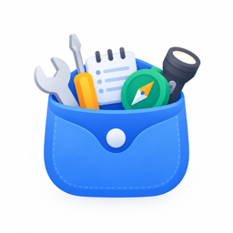
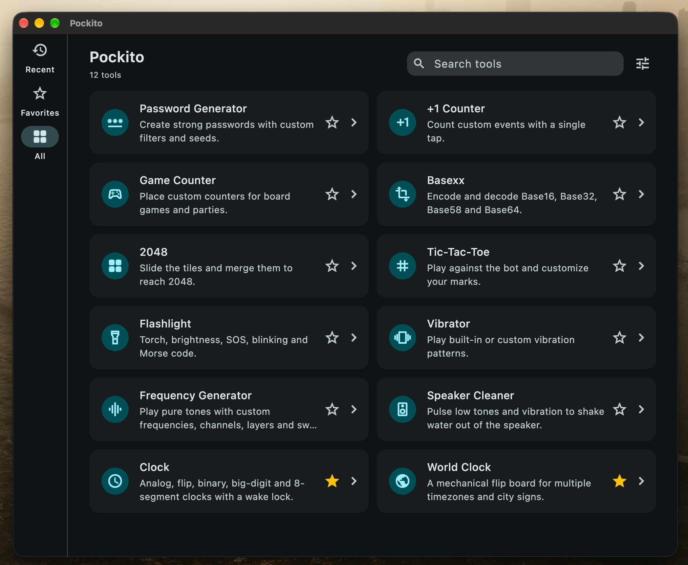
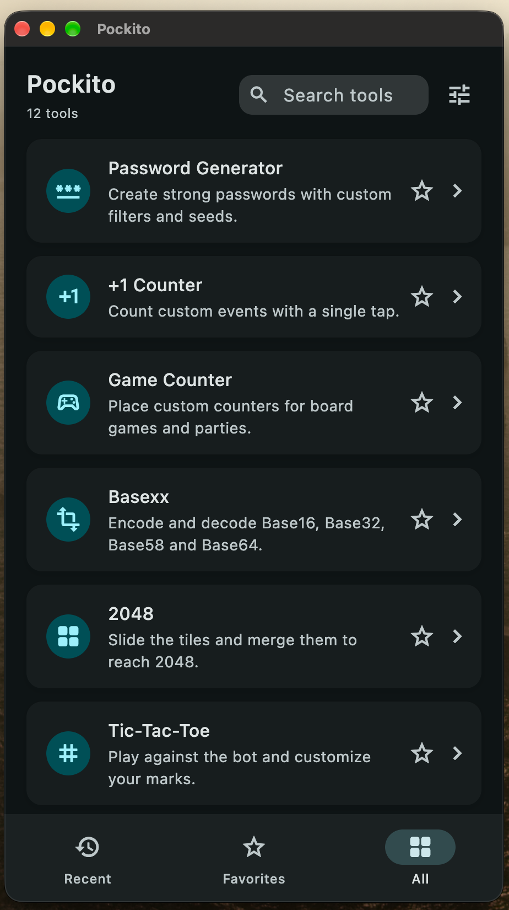
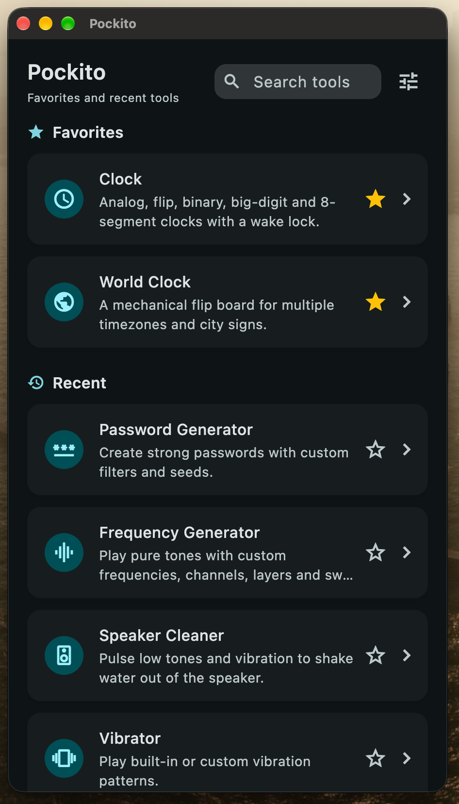

> Vibe coded with DeepSeek V4.1 Flash 1017 / OpenCode

<p align="center">
  
</p>

<h1 align="center">Pockito · 妙物袋</h1>

<p align="center">
  English · <a href="README.zh-CN.md">简体中文</a>
</p>

<p align="center">
  <a href="https://flutter.dev"></a>
  <a href="https://dart.dev"></a>
  
  
  
  
  
  <a href="LICENSE"></a>
  
</p>

Pockito is a local-first collection of small tools for Android, iOS, macOS, Windows and Linux, with a hidden encrypted notes vault. Twelve utilities live behind one searchable home screen; everything runs on the device, with no account, cloud sync or telemetry.

## Screenshots

<table>
  <tr>
    <td align="center"><br><sub>Desktop</sub></td>
    <td align="center"><br><sub>Mobile</sub></td>
    <td align="center"><br><sub>Minimal mode</sub></td>
  </tr>
</table>

## Highlights

- **12 tools in one app** — passwords, counters, board-game scoring, encoding, games, light, haptics, audio, clock and world clock.
- **Local-first** — tools, preferences and notes stay on the device. Nothing is uploaded.
- **Search everything** — search by title, description, tag or tool ID, with bilingual results.
- **Minimal mode** — hide the tab bar, merge Favorites and Recent into one page and keep search across all tools.
- **Tool details** — every tool has a details page with scope, platform support, tags, version, dates and known limitations.
- **Hidden vault** — a long press on a page title opens an encrypted notes area protected by a pattern or PIN.

## Tools

- **Password Generator** — generate 8–64 character passwords with lowercase, uppercase, number and symbol filters. Unique-character and look-alike exclusion options can be toggled independently; custom seeds can be typed or captured from mouse and touch gestures. Results can be copied in one tap with coloured character highlighting, and all filters can be reset.
- **+1 Counter** — create counters for any event, then increment, decrement, set the current value, reset, rename or delete them. A total is shown for all counters, and every change is recorded with its time, delta and resulting value in a per-counter history that can be cleared.
- **Game Counter** — score board games and parties. Scenes define shared counter types (health, magic, points…) used by every player; a new scene starts with one counter type and two players, and the player count can be adjusted directly. Each counter type can define the default tap direction (+1/−1) and starting value. Reset and rotate live in each panel menu, scene switching is in the title menu, and a single action resets all counters. Settings manage scenes, types and players only; values and history stay separate, and history is cleared with a counter type.
- **Basexx** — encode and decode text between Base16, Base32, Base58, Base64 and Base64 URL, with input/output swapping and one-tap copy.
- **2048** — the classic sliding-tile game with swipe and arrow-key/WASD input, score, locally saved best scores, a win prompt and quick restart. Boards come in 3×3 (target 256), 4×4 (2048), 5×5 (4096) and 6×6 (8192) sizes with independent records. An expectimax auto-play bot can be watched and stops when the game ends.
- **Tic-Tac-Toe** — play against a bot (easy, normal or hard with minimax) or with a second player on the same device. Custom marks are saved locally, and wins, draws and losses are counted. Quick result detection ends a game early when the outcome is already decided.
- **Flashlight** — detects torch support first, then offers steady on/off, native brightness levels (Android 13+ / iOS 14+), SOS, timed blinking and Morse code. Letters, digits and Chinese text (converted to pinyin) can be sent as Morse. Desktop platforms fall back to Morse code only.
- **Vibrator** — play built-in or custom vibration patterns, including tap, double tap, triple tap, long buzz, heartbeat, SOS, ripple, tick and alarm. Three styles (soft, standard, crisp) shape each pulse; custom patterns accept comma-separated on/off durations in milliseconds and can loop. Amplitude is adjustable on supported hardware, and desktop platforms preview patterns without a motor.
- **Frequency Generator** — generate pure tones from 20 Hz to 20 kHz as sine, square, triangle or sawtooth waves. Frequency can be set with a logarithmic slider, exact input, ±1/±10 Hz steps, ÷2/×2 and presets, and changed live during playback along with waveform and volume. The header shows the equal-tempered note, cent offset, period and wavelength. Up to four layers can be panned left, right or centre with automatic gain staging, and each layer supports a 1–3600 second linear or logarithmic sweep with loop. The 100 Hz preset includes a motion-sickness note with the 2025 research reference, playback can be timed (1/5/10/30 minutes or unlimited) with a countdown, and audio continues in the background until stopped. Start at a low volume.
- **Speaker Cleaner** — pulse 60–1000 Hz tones (165 Hz sine by default) to help shake water out of a speaker opening. Four rhythms (gentle, standard, strong, fast), separate tone and silence durations, 10/20/30/45 second auto-stop, live frequency and volume, and optional vibration synced to the pulses on phones. Desktop platforms play audio only. Remove the case, face the speaker down on a dry cloth, start around 60–70% volume and never insert anything into the speaker grille.
- **Clock** — five faces (analog, flip, binary, big digits and 8-segment), switched by swiping, the bottom dots or the arrows. Layouts follow the device or window automatically, or can be forced to portrait or landscape. Settings cover looping, 12/24-hour time (system/language by default) and per-face options such as size, hands, seconds, dates, labels, colours, borders and spacing. The screen stays awake by default from a monitor icon, the palette icon switches the clock-only appearance (app/light/dark) and 8 accents without affecting other tools, and fullscreen hides the system bars or expands the desktop window. Each face can be reset individually or all at once.
- **World Clock** — an airport flip-board for several time zones. Each row shows local time on mechanical digits with an English city sign (airport code, city, Chinese name and region). Text, flip and cards-only modes are available; flip animates each letter of the city name and cards-only hides codes, small text, dates and descriptions. Cities can be searched, added and removed, with 12/24-hour time, seconds, dates, UTC offsets, time-zone abbreviations and day/night markers. Times use the IANA database, including daylight saving time.

## Home and navigation

- **Views** — Recent, Favorites, All and Settings. Recent is ordered by open time; favorites are toggled with the star on any tool card. Every view can be shown or hidden in Settings, and at least one of Recent, Favorites and All must stay visible. Settings can be hidden too; the gear beside the search field opens it when hidden.
- **Remember last view** — optional. When disabled, the app starts on All (or the first available tool view).
- **Search** — searches titles, descriptions, tags and tool IDs in both languages. The field sits inline with the page title, expands slightly on focus on mobile without covering the title, and clears on blur or submit. Clear-recent and clear-favorites actions live in Settings.
- **Responsive layout** — desktop and landscape tablets use a navigation rail, a 1120 px content area and a two- or three-column tool grid. Cards in the same row share the tallest height, descriptions are capped at two lines with an ellipsis, and short content is centred. Narrow screens use bottom navigation and a single-column list. The All view heading is the app name, and the mobile home has no extra app bar above it.
- **Minimal mode** — hides the tab navigation, folds Settings into the gear beside search, merges Favorites and Recent into one page (favorites first, no duplicates), removes the All view and keeps search across every tool. An empty state appears when there is no history yet.

## Tool details

Every tool page has an info button in the top-right corner. The details page shows the same description as the home card, what the tool is best for, per-platform support for Android, iOS, macOS, Windows and Linux (supported, partial or not available, with platform notes), 2–5 bilingual tags that also participate in search, the version (currently 1.0), release and last-updated dates based on feature changes, known limitations, and the tool's open-source acknowledgements with license badges and clickable links.

## Appearance and language

The tool list, unlock screen and notes share one theme and language setting: light, dark or system; 12 accent colours; Android 12+ Material You wallpaper colours; English, Chinese or system language. Settings are saved to `tool_prefs.json`. The clock additionally has its own light/dark/theme-follow and accent palette.

## Hidden notes vault

- Long-press a page title on the home screen, or the Password Generator title, to open the vault.
- On first use, create either a 3×3 pattern or a numeric PIN. There is no biometric unlock and no recovery key.
- Notes support a title, body text and image attachments.
- The vault is stored in a single `pockito-cache.pvlt` file in the app support directory.

## Data on device

| File | Contents |
| --- | --- |
| `tool_prefs.json` | Theme, language, accent colour, home views, recent/favorites, minimal mode |
| `tool_counters.json` | +1 counters and their history |
| `tool_game_counters.json` | Game counter scenes, types, players and history |
| `tool_clock.json` | Clock faces, layout, wake lock and appearance |
| `tool_world_clock.json` | World clock cities and display options |
| `pockito-cache.pvlt` | Encrypted notes vault |

All files live in the app support directory and use plain preference storage unless they belong to the vault.

## Security boundaries

The vault is not SQLite but a custom versioned envelope. Note payloads are encrypted with AES-256-GCM; the key is derived from the pattern or PIN with PBKDF2-HMAC-SHA256 (210,000 iterations) and a random salt stored in the file. Unlocking re-derives the key with the same credential, and a MAC failure means the credential is wrong. Writes finish a `.writing` file and flush it before moving the previous file to `.backup` and replacing the main file; interrupted writes are recovered on launch. This covers app crashes and most process interruptions, but it is not a substitute for filesystem, disk or hardware backups.

This is a working foundation, not an audited password manager. Pattern and PIN entropy is limited, so do not use it for highly sensitive data. If the pattern or PIN is forgotten, the notes cannot be decrypted.

## Getting started

Requirements: a Flutter SDK with Dart `^3.13.2`. The project targets Android, iOS, Windows, macOS and Linux; Web is not a target.

```bash
flutter pub get
flutter run -d macos
```

Use `flutter devices` to list configured Android, iOS, Windows, macOS and Linux devices.

On iOS and macOS the native plugins use Swift Package Manager. If it was disabled on the machine, run `flutter config --enable-swift-package-manager` first; otherwise Flutter falls back to CocoaPods and generates a `Podfile`. Audio on Linux needs ALSA, PulseAudio or PipeWire at runtime.

```bash
flutter analyze
flutter test

flutter build macos --debug
flutter build ios --debug --no-codesign
flutter build apk --release --split-per-abi
```

The arm64 release APK is written to `build/app/outputs/flutter-apk/app-arm64-v8a-release.apk`.

## Acknowledgements

The code was written with LLM-assisted Vibe Coding. The projects below are references for features and interaction only; their source code was not used. Their licenses and links are listed as credit.

- [Password Generator](https://gitlab.com/vecturagames/passwordgenerator) by Vectura Games — Apache License 2.0. Inspiration for the password generator.
- [Counters](https://gitlab.com/neil3000/counters) by Neïl Rahmouni — GNU Affero General Public License v3.0. Inspiration for the +1 counter.
- [gamecounter](https://github.com/multun/gamecounter) by multun — GNU General Public License v3.0. Inspiration for the game counter.
- [Dooz](https://github.com/yamin8000/Dooz) by yamin8000 — GNU General Public License v3.0. Inspiration for Tic-Tac-Toe.
- [FlashDim](https://github.com/cyb3rko/flashdim) by cyb3rko — Apache License 2.0. Inspiration for the flashlight.
- [Vibrator](https://github.com/xiaofeidev/Vibrator) by xiaofeidev — Apache License 2.0. Inspiration for the vibrator.
- [MotionEaseTune](https://github.com/BHznJNs/MotionEaseTune) by BHznJNs — GNU General Public License v3.0. Inspiration for the 100 Hz motion-sickness note.

Runtime dependencies: [flutter_soloud](https://github.com/alnitak/flutter_soloud) (MIT, includes SoLoud and miniaudio; built with `no_xiph_libs`, so no Ogg/Vorbis/Opus/FLAC decoders are bundled), [wakelock_plus](https://pub.dev/packages/wakelock_plus) (BSD 3-Clause), [window_manager](https://pub.dev/packages/window_manager) (MIT), [timezone](https://pub.dev/packages/timezone) (BSD 3-Clause) and [dynamic_color](https://pub.dev/packages/dynamic_color) (BSD 3-Clause). In-app acknowledgements are shown on each tool's details page.

## License

Pockito is released under the [MIT License](LICENSE).

Source code: [github.com/whynbnb/pockito](https://github.com/whynbnb/pockito). The same license and repository link are available in the app at **Settings → About**, together with the version (1.0) and the full license text.
