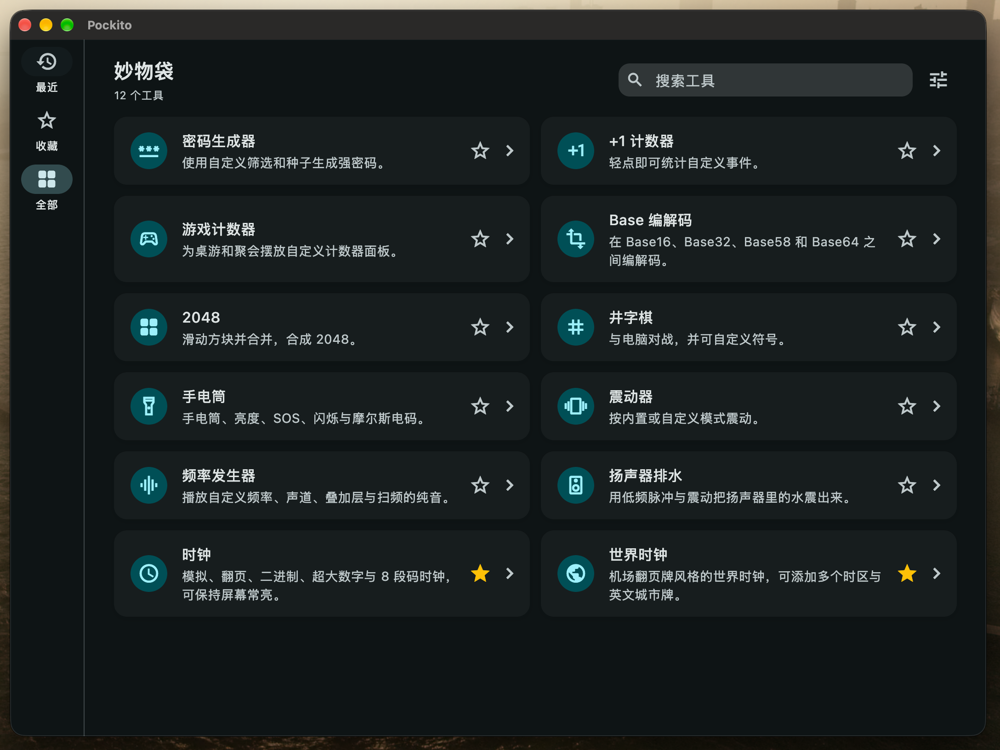
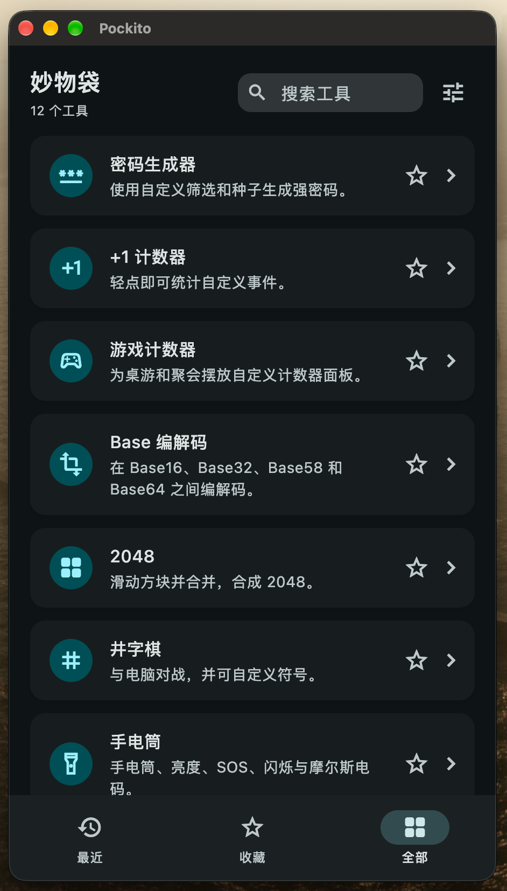
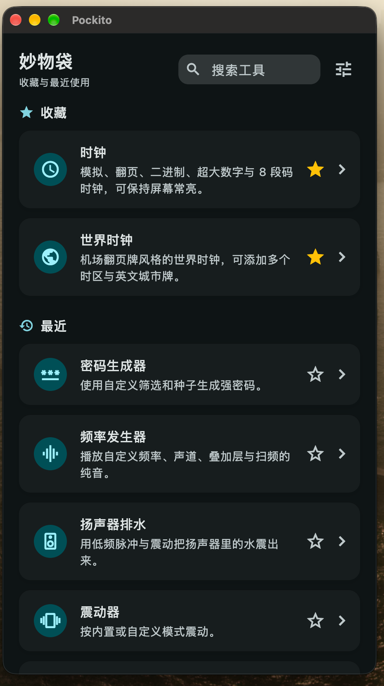

> Vibe Coding而成（DeepSeek V4.1 Flash 1017 / OpenCode）

<p align="center">
  
</p>

<h1 align="center">妙物袋 · Pockito</h1>

<p align="center">
  <a href="README.md">English</a> · 简体中文
</p>

<p align="center">
  <a href="https://flutter.dev"></a>
  <a href="https://dart.dev"></a>
  
  
  
  
  
  <a href="LICENSE"></a>
  
</p>

妙物袋是一个面向 Android、iOS、macOS、Windows 和 Linux 的本地优先小工具集合，并附带一个隐藏的加密笔记保险库。十二个小工具收在同一个可搜索的首页里，全部在设备本地运行，不需要账号，也没有云同步或遥测。

## 界面预览

<table>
  <tr>
    <td align="center"><br><sub>桌面端</sub></td>
    <td align="center"><br><sub>移动端</sub></td>
    <td align="center"><br><sub>极简模式</sub></td>
  </tr>
</table>

## 亮点

- **一个小工具集合**：密码、计数器、桌游计分、编解码、小游戏、照明、触感、音频、时钟与世界时钟。
- **本地优先**：工具、设置与笔记都只保存在设备上，不会上传。
- **全局搜索**：按中英文标题、描述、标签或工具 ID 搜索。
- **极简模式**：隐藏 tab 导航，把收藏与最近合并到一页，搜索仍覆盖全部工具。
- **工具详细信息**：每个工具都有独立详情页，展示适用范围、平台适配、标签、版本、日期与已知缺陷。
- **隐藏保险库**：长按页面标题进入加密笔记区域，使用九宫格图案或数字 PIN 解锁。

## 小工具

- **密码生成器**：生成 8–64 位密码，可分别筛选小写、大写、数字和特殊字符。唯一字符与排除易混淆字符可独立开启；自定义种子支持手动输入，也支持采集鼠标移动和触摸轨迹。结果支持一键复制、字符类型彩色高亮和恢复初始设置。
- **+1 计数器**：为任意事件创建计数器，支持加一、减一、设置当前值、归零、重命名和删除，并显示所有计数器的总计。每次变更都会记录时间、增减量和变更后的值，可在计数器的记录页查看或清除。
- **游戏计数器**：面向桌游和聚会。每个场景定义所有玩家共享的计数器类型（血量、魔法值、分数等）；新场景默认包含一个计数器类型和两名玩家，玩家数量可直接调整。每种计数器类型可设置默认点击方向（+1 / −1）和默认数值。归零和旋转收在面板菜单中，场景切换在标题菜单里，另有一键清零全部计数器。设置页只管理场景、类型和玩家，数值与历史独立保存；删除计数器类型会一并清除对应历史记录。
- **Basexx**：在 Base16、Base32、Base58、Base64 和 Base64 URL 之间编解码文本，支持互换输入输出与一键复制。
- **2048**：经典滑动方块游戏，支持滑动和方向键 / WASD，包含得分、本地最高分、胜利提示和快速重开。提供 3×3（目标 256）、4×4（目标 2048）、5×5（目标 4096）和 6×6（目标 8192）四种棋盘，各自记录最高分。内置 expectimax 自动游玩 bot，可随时开关观战，游戏结束自动停止。
- **井字棋**：支持人机和双人模式。人机难度分为简单 / 普通 / 困难（困难使用 minimax 最优策略），可自定义双方符号并本地保存，同时记录胜、平、负。开启快速判定后，出现无法阻挡的必胜局面或必然平局时会提前结束。
- **手电筒**：先检测设备是否支持手电筒，再提供常亮 / 关闭、原生亮度级别（Android 13+ / iOS 14+）、SOS、定时闪烁和摩尔斯电码。字母、数字和中文（自动转拼音）都可转成摩尔斯发送；桌面平台仅保留摩尔斯电码。
- **震动器**：播放内置或自定义震动模式，包括轻点、双击、三连击、长震、心跳、SOS、涟漪、滴答和警报。柔和 / 标准 / 哒哒哒三种风格会改变每次震动的质感；自定义模式使用逗号分隔的毫秒时长，可循环播放。支持的硬件上可调节强度，桌面平台仅作模式预览。
- **频率发生器**：生成 20 Hz 到 20 kHz 的纯音，可选正弦波、方波、三角波和锯齿波。频率可通过对数滑块、精确输入、±1 / ±10 Hz 微调、÷2 / ×2 和预设调节，播放中可实时改变频率、波形和音量。顶部显示十二平均律音名、音分偏差、周期和波长。最多四个音调层可分配到左、右或双声道并自动分配增益，每层支持 1–3600 秒的线性 / 对数扫频与往返循环。100 Hz 预设附带缓解晕车的 2025 年研究说明；播放可设为 1 / 5 / 10 / 30 分钟或不限时并显示倒计时，切到后台后仍会继续播放，直到手动停止。请从低音量开始。
- **扬声器排水**：用 60–1000 Hz 的低频脉冲（默认 165 Hz 正弦波）帮助震出扬声器开孔附近的水。提供轻柔 / 标准 / 强劲 / 快速四种节奏、独立的发声与静音时长、10 / 20 / 30 / 45 秒自动停止、实时频率和音量；手机上可开启与脉冲同步的震动，桌面平台仅播放音频。建议取下保护壳、扬声器朝下放在干布上，音量从 60–70% 开始，不要用物体插入扬声器开孔。
- **时钟**：提供模拟圆形、数字翻页、二进制点阵、超大数字和 8 段码五种表盘，可通过滑动、底部圆点或箭头切换。布局可跟随设备或窗口自动调整，也可强制竖屏 / 横屏。设置包括循环滑动、12 / 24 小时制（默认跟随系统与语言）以及各表盘尺寸、指针、秒数、日期、标签、颜色、边框和间距等选项。默认保持屏幕常亮（显示器图标可关闭）；调色盘图标可单独切换时钟的跟随应用 / 浅色 / 深色主题和 8 种强调色，不影响其他工具；全屏会隐藏系统栏或扩展桌面窗口。每个表盘可单独重置，也可全部重置。
- **世界时钟**：机场翻页牌风格，一屏显示多个时区。每行用机械翻页数字显示当地时间，并配有英文城市牌（三字代码、英文城市名、中文名与地区）。可选文字、翻页、纯卡片三种样式；翻页会把英文城市名的每个字母做成机械翻页卡片，纯卡片则隐藏代码、小字、日期和描述。城市可搜索、添加和移除，支持 12 / 24 小时制、秒数、日期、UTC 时差、时区缩写和昼夜标记。时区使用 IANA 数据计算，包含夏令时。

## 首页与导航

- **界面**：最近、收藏、全部、设置。最近按打开时间排序，收藏通过工具卡片上的星标切换。每个界面都可以在设置中显示或隐藏，最近、收藏、全部至少保留一个；设置界面也可以隐藏，隐藏后通过搜索框右侧的齿轮进入。
- **记住上次界面**：可选。关闭后启动时回到「全部」（若全部被隐藏则回到第一个可用工具界面）。
- **搜索**：按中英文标题、描述、标签或工具 ID 搜索。搜索框与页面标题同一行，移动端聚焦时略微变长且不遮挡标题，失焦或提交后收起。清空最近和清空收藏的操作集中在设置中。
- **响应式布局**：桌面和横屏平板使用左侧导航、1120 px 内容区和双列 / 三列工具网格；同一行卡片等高，描述最多两行、超出省略，内容较短时垂直居中。窄屏使用底部导航与单列列表。「全部」界面的标题是软件名，移动端不再额外显示应用栏。
- **极简模式**：隐藏 tab 导航，把设置收进搜索框右侧的齿轮，把收藏与最近合并到同一页（收藏优先、不重复），不再显示「全部」，但搜索仍会检索所有工具。暂无历史时显示空状态。

## 工具详细信息

每个工具页面的右上角都有一个信息按钮。详情页展示与首页一致的工具描述、适用范围、Android / iOS / macOS / Windows / Linux 的适配情况（支持 / 部分支持 / 不支持，并附平台说明）、2–5 个同时参与搜索的中英文标签、版本（当前为 1.0）、按功能变更整理的发布日期与最后更新日期、已知缺陷，以及该工具的开源致谢（许可证徽章与可点击链接）。

## 外观与语言

工具列表、解锁页和笔记共用主题与语言设置：浅色 / 深色 / 跟随系统、12 种强调色、Android 12+ 的 Material You 壁纸取色，以及 English / 中文 / 跟随系统。设置保存在 `tool_prefs.json`。时钟还可以单独设置跟随应用 / 浅色 / 深色和 8 种强调色。

## 隐藏笔记保险库

- 在首页长按页面标题，或长按密码生成器的标题，进入保险库。
- 首次使用时创建九宫格图案或数字 PIN，不支持生物识别，也没有恢复密钥。
- 笔记支持标题、正文和图片附件。
- 保险库保存在应用支持目录下的单个 `pockito-cache.pvlt` 文件中。

## 本地数据

| 文件 | 内容 |
| --- | --- |
| `tool_prefs.json` | 主题、语言、强调色、首页界面、最近 / 收藏、极简模式 |
| `tool_counters.json` | +1 计数器及其历史 |
| `tool_game_counters.json` | 游戏计数器的场景、类型、玩家和历史 |
| `tool_clock.json` | 时钟表盘、布局、屏幕常亮与外观 |
| `tool_world_clock.json` | 世界时钟的城市与显示选项 |
| `pockito-cache.pvlt` | 加密笔记保险库 |

以上文件都位于应用支持目录；除保险库外均使用普通偏好存储。

## 安全边界

保险库不是 SQLite，而是自定义的版本化 envelope。笔记 payload 使用 AES-256-GCM 加密，密钥由九宫格图案或 PIN 通过 PBKDF2-HMAC-SHA256（210,000 次迭代）和文件内随机 salt 派生；解锁时用相同凭据重新派生，MAC 校验失败即视为凭据错误。写入时会先完成 `.writing` 文件并 flush，再把旧文件移到 `.backup`，最后替换主文件；启动时会恢复有效的中断写入。该机制覆盖应用崩溃和大多数进程中断，但不能替代文件系统、磁盘或硬件损坏时的备份。

这是可运行的基础版本，不是经过安全审计的密码管理器。图案与 PIN 的熵有限，请勿用于保护高度敏感的数据；一旦忘记图案或 PIN，笔记将无法解密。

## 运行

环境要求：Flutter SDK（Dart `^3.13.2`）。项目目标为 Android、iOS、Windows、macOS 和 Linux，不包含 Web。

```bash
flutter pub get
flutter run -d macos
```

使用 `flutter devices` 查看已配置的 Android、iOS、Windows、macOS 和 Linux 设备。

iOS / macOS 原生插件通过 Swift Package Manager 集成。如果本机曾关闭该功能，请先执行 `flutter config --enable-swift-package-manager`，否则 Flutter 会退回 CocoaPods 并生成 `Podfile`。Linux 播放音频需要系统提供 ALSA、PulseAudio 或 PipeWire。

```bash
flutter analyze
flutter test

flutter build macos --debug
flutter build ios --debug --no-codesign
flutter build apk --release --split-per-abi
```

arm64 安装包输出到 `build/app/outputs/flutter-apk/app-arm64-v8a-release.apk`。

## 致谢

本项目的代码由 LLM 辅助的 Vibe Coding 方式编写。以下开源项目仅作为功能与交互上的参考，未参考其源代码；相关许可证与链接列出以表达致意。

- [Password Generator](https://gitlab.com/vecturagames/passwordgenerator)，作者 Vectura Games — Apache License 2.0，密码生成器的灵感来源。
- [Counters](https://gitlab.com/neil3000/counters)，作者 Neïl Rahmouni — GNU Affero General Public License v3.0，+1 计数器的灵感来源。
- [gamecounter](https://github.com/multun/gamecounter)，作者 multun — GNU General Public License v3.0，游戏计数器的灵感来源。
- [Dooz](https://github.com/yamin8000/Dooz)，作者 yamin8000 — GNU General Public License v3.0，井字棋的灵感来源。
- [FlashDim](https://github.com/cyb3rko/flashdim)，作者 cyb3rko — Apache License 2.0，手电筒的灵感来源。
- [Vibrator](https://github.com/xiaofeidev/Vibrator)，作者 xiaofeidev — Apache License 2.0，震动器的灵感来源。
- [MotionEaseTune](https://github.com/BHznJNs/MotionEaseTune)，作者 BHznJNs — GNU General Public License v3.0，100 Hz 缓解晕车说明的灵感来源。

运行时依赖：[flutter_soloud](https://github.com/alnitak/flutter_soloud)（MIT，内含 SoLoud 与 miniaudio；启用了 `no_xiph_libs`，不会打包 Ogg / Vorbis / Opus / FLAC 解码库）、[wakelock_plus](https://pub.dev/packages/wakelock_plus)（BSD 3-Clause）、[window_manager](https://pub.dev/packages/window_manager)（MIT）、[timezone](https://pub.dev/packages/timezone)（BSD 3-Clause）和 [dynamic_color](https://pub.dev/packages/dynamic_color)（BSD 3-Clause）。应用内的致谢显示在各工具的详细信息页面。

## 开源协议

妙物袋基于 [MIT License](LICENSE) 开源。

源码地址：[github.com/whynbnb/pockito](https://github.com/whynbnb/pockito)。应用内「设置 → 关于」同样可以查看版本（1.0）、完整协议文本与仓库链接。
